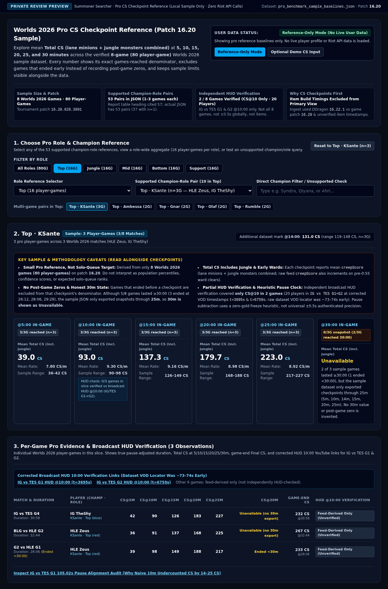
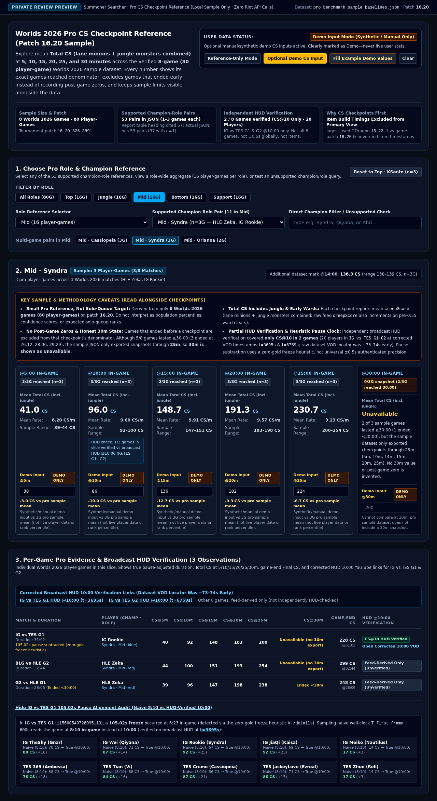
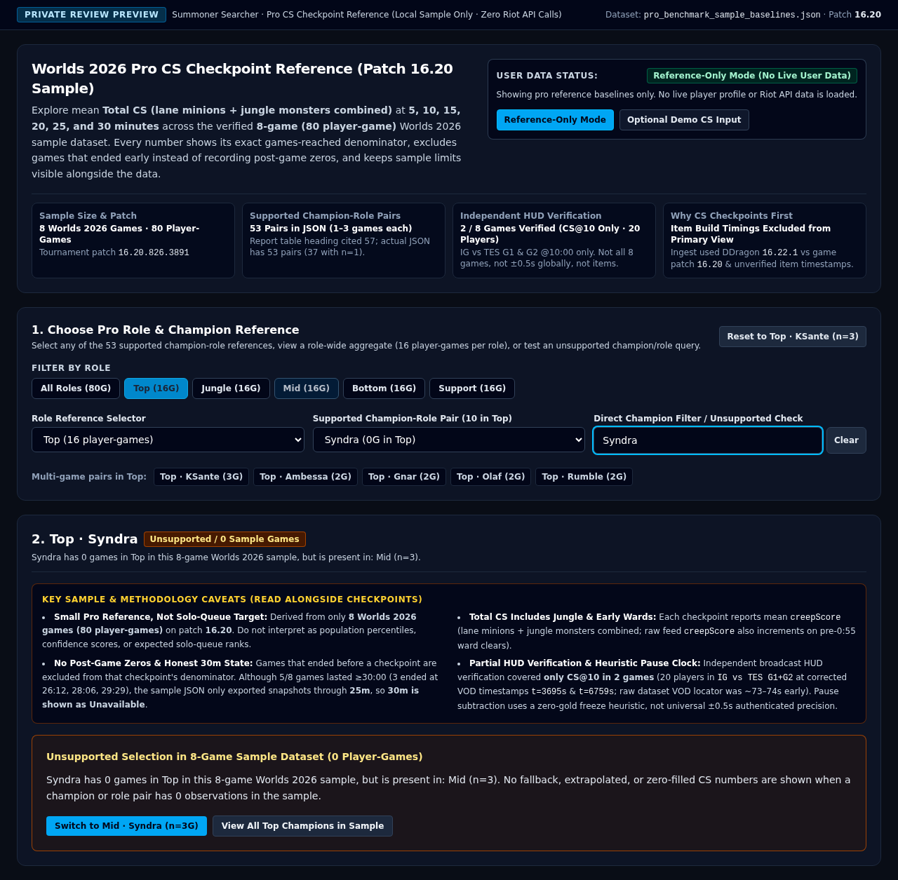
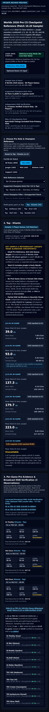
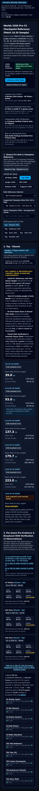

# Pro CS Checkpoint Reference UI Preview — Visual & Behavioral Review

- **Branch**: `feature/pro-comparison-ui-preview` (isolated from `master`; production routing in `src/nav/NavigationLayout.tsx`, `src/App.tsx`, `src/main.tsx`, and `index.html` is **100% untouched**)
- **Standalone Retrievable Single-File HTML Build**: [`./pro-comparison-standalone-artifact.html`](./pro-comparison-standalone-artifact.html) (self-contained 715 KB HTML bundle with inline CSS, React UI, and the verified 8-game / 80-player dataset—can be downloaded and opened directly via `file://` in any browser with zero server or network dependencies)
- **Local Vite Dev Entry Point**: `/pro-comparison-preview.html` (`npm run dev` -> `http://localhost:5173/pro-comparison-preview.html`)

---

## 1. Rendered Key-Feature Screenshots (Desktop `1280px` & Mobile `390px` / `320px`)

### 1.1 Desktop (`1280x900`) — Default Reference-Only Mode (`Top · KSante`, `n=3`)
- Shows `Reference-Only Mode (No Live User Data)` active by default.
- Displays mean Total CS (lane + jungle combined) at `5m` (`39.0 CS`), `10m` (`93.0 CS`), `15m` (`137.3 CS`), `20m` (`179.7 CS`), `25m` (`223.0 CS`) with `3/3G reached (n=3)` denominators, secondary `@14:00` pill (`131.0 CS`), and honest **`Unavailable`** state at `30m` (`0/3G snapshot (2/3G reached 30:00)`).
- Inline caveats sit directly above the checkpoint cards.

---

### 1.2 Desktop (`1280x900`) — `Mid · Syndra` (`n=3`) with HUD-Verified 10:00 VOD Links, Optional Demo CS Input Mode, and `IG vs TES G1` `105.02s` Pause Audit
- Demonstrates **Optional Demo CS Input Mode** where every input box and delta is explicitly badged **`DEMO ONLY`** / **`Demo Input Mode (Synthetic / Manual Only)`** (`not live player data or rank percentile`), and `30m` comparison is disabled (`Cannot compare at 30m: pro sample dataset does not include a 30m snapshot`).
- Per-game evidence table shows `IG Rookie (Syndra)` in `IG vs TES G1` with the green **`CS@10 HUD Verified`** badge and corrected YouTube link (`https://www.youtube.com/watch?v=HtgoZzoC4Lo&t=3695s`), alongside `HLE Zeka (Syndra)` in `BLG vs HLE G2` and `G2 vs HLE G1` marked **`Feed-Derived Only (Unverified)`**.
- Bottom panel expands the **`IG vs TES G1` `105.02s` Pause Alignment Audit** across all 10 players (`Naive 8:10` vs `True @10:00` HUD-verified at `t=3695s`).

---

### 1.3 Desktop (`1280x900`) — Honest Empty / Unsupported Role-Champion Selection State (`Top · Syndra`)
- Selecting or searching `Syndra` under `Top` displays `Unsupported Selection in 8-Game Sample Dataset (0 Player-Games)` (`Syndra has 0 games in Top in this 8-game Worlds 2026 sample, but is present in: Mid (n=3)`), never inventing fallback or zero-filled numbers, and provides a one-click button to switch to `Mid · Syndra (n=3G)`.

---

### 1.4 Mobile `390px` (`390x844`) — Zero Horizontal Overflow (`scrollWidth: 390 === innerWidth: 390`)
- All controls, caveat cards, checkpoint cards, per-game evidence cards, and pause audit cards stack cleanly at `390px` width without horizontal scrolling or clipped text.

---

### 1.5 Mobile `320px` (`320x780`) — Small Phone Viewport, Zero Horizontal Overflow (`scrollWidth: 320 === innerWidth: 320`)
- Verified at `320px` minimum phone width with `scrollWidth: 320 === innerWidth: 320`.

